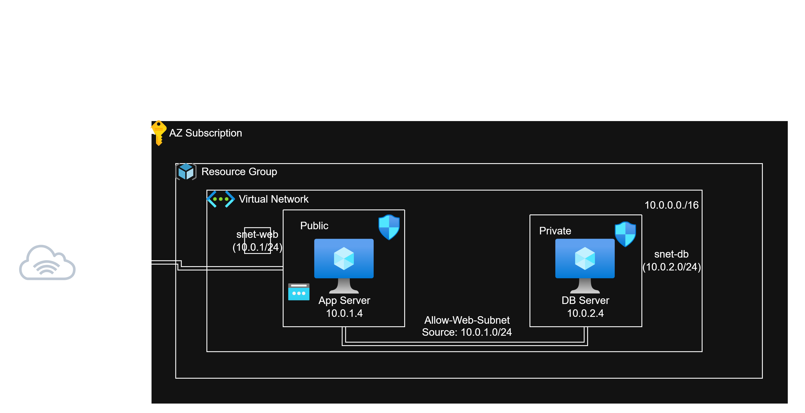

# ☁️ Lab 02: Building a Secure 2-Tier Web Application


**Author:** Krishnadeep Chudasama · **Estimated Time:** 60 minutes · **Difficulty:** Beginner

🎥 **WATCH ME COMPLETE THIS LAB HERE:**

https://www.loom.com/share/f203140d3a6e402480250c1dad1c6f02

<!-- TODO: replace the line above with the Loom link once the video is recorded -->

## 📋 Table of Contents
- [Objective](#-objective)
- [Architecture Diagram](#-architecture-diagram)
- [Prerequisites](#-prerequisites)
- [Lab Variables](#-lab-variables)
- [Step-by-Step Instructions](#-step-by-step-instructions)
  - [Phase 1: The Network Foundation](#phase-1-the-network-foundation)
  - [Phase 2: Deploying the Web Server (The Front End)](#phase-2-deploying-the-web-server-the-front-end)
  - [Phase 3: Deploying the Database Server (The Back End)](#phase-3-deploying-the-database-server-the-back-end)
  - [Phase 4: Validating Connectivity (The Jump)](#phase-4-validating-connectivity-the-jump)
  - [Phase 5: Configuring the Firewall (NSG)](#phase-5-configuring-the-firewall-nsg)
- [Security Notes](#-security-notes)
- [Troubleshooting](#-troubleshooting)
- [Clean Up Resources](#-clean-up-resources)

---

## 🎯 Objective
In this lab, you will build a classic "IaaS" architecture. You will create a Virtual Network with two subnets: a "Public" subnet for a Web Server and a "Private" subnet for a Database Server. You will configure Network Security Groups (NSGs) so the Database Server has no exposure to the internet and is reached only through the Web Server.

## 🏗️ Architecture Diagram



**How to read it:** The internet reaches only `vm-web-01` (HTTP and SSH). `vm-db-01` has no public IP and is reachable only from the web subnet (`10.0.1.0/24`), so administrators "jump" through the web server to get to it.

## ✅ Prerequisites
- [x] Active Azure Subscription
- [x] Terminal installed

## ⚙️ Lab Variables (Naming Convention)
Use these naming conventions to ensure consistency throughout the deployment:
* **Resource Group:** `rg-lab02-krish`
* **VNet Name:** `vnet-lab02` (`10.0.0.0/16`)
* **Subnet 1 (Public):** `snet-web` (`10.0.1.0/24`)
* **Subnet 2 (Private):** `snet-db` (`10.0.2.0/24`)
* **Web VM:** `vm-web-01`
* **Database VM:** `vm-db-01`

---

## 🚀 Step-by-Step Instructions

### Phase 1: The Network Foundation
1. Search for **Virtual Networks** in the Azure Portal and click **Create**.
2. **Basics:**
   - **Resource Group:** Create New -> `rg-lab02-krish`
   - **Name:** `vnet-lab02`
   - **Region:** East US
3. **IP Addresses:**
   - **IPv4 Address Space:** `10.0.0.0/16`
   - **Subnet 1:** Name: `snet-web`, Range: `10.0.1.0/24`
   - **Subnet 2:** Name: `snet-db`, Range: `10.0.2.0/24`
4. Click **Review + create** -> **Create**.

### Phase 2: Deploying the Web Server (The Front End)
1. Search for **Virtual Machines** and click **Create** -> **Azure virtual machine**.
2. **Basics:**
   - **Resource Group:** `rg-lab02-krish`
   - **Virtual machine name:** `vm-web-01`
   - **Region:** East US
   - **Image:** Ubuntu Server 22.04 LTS
   - **Size:** Standard_B1s
   - **Authentication type:** SSH public key
   - **Key pair name:** `key-lab02`
   - **Public inbound ports:** Allow selected -> HTTP (80) and SSH (22).
3. **Networking:**
   - **Virtual Network:** `vnet-lab02`
   - **Subnet:** Ensure `snet-web` is selected.
   - **Public IP:** Create New (Standard).
4. Click **Review + create** -> **Create**.
5. Download the Private Key (`.pem`) if prompted and save it securely.

### Phase 3: Deploying the Database Server (The Back End)
Now we deploy the server that represents our database.
1. Create another Virtual Machine.
2. **Basics:**
   - **Resource Group:** `rg-lab02-krish`
   - **Virtual machine name:** `vm-db-01`
   - **Region:** East US
   - **Image:** Ubuntu Server 22.04 LTS
   - **Size:** Standard_B1s
   - **Key pair name:** Use existing key stored in Azure -> `key-lab02`
   - **Public inbound ports:** Allow selected -> SSH (22).
3. **Networking (CRITICAL STEP):**
   - **Virtual Network:** `vnet-lab02`
   - **Subnet:** Change this to `snet-db`.
   - **Public IP:** Select **None**. *(This is a private server; it should not have a public IP).*
4. Click **Review + create** -> **Create**.

### Phase 4: Validating Connectivity (The Jump)
Since `vm-db-01` has no public IP, you cannot connect to it directly from your home computer. You must connect to the Web Server first, and "jump" to the DB server.
1. **Get the Private IP of the DB Server:**
   - Go to the `vm-db-01` resource overview. Look for **Private IP address** (it should be `10.0.2.4`). Copy this address.
2. **SSH into the Web Server:**
   - Open your terminal and SSH into `vm-web-01` using its Public IP:
     ```bash
     ssh -i key-lab02.pem azureuser@[public-ip-of-web]
     ```
3. **Test Connectivity:**
   - From inside the Web Server terminal, try to ping the Database Server:
     ```bash
     ping 10.0.2.4
     ```
   - You should see successful replies! This proves the two servers are connected securely inside the VNet.
   - Press `Ctrl + C` to stop the ping.

### Phase 5: Configuring the Firewall (NSG)
Right now, `vm-db-01` is accepting traffic. We want to make the intent explicit: the Web Subnet is allowed to talk to it.
1. Go to the **Networking** tab of `vm-db-01`.
2. Click on the attached Network Security Group (e.g., `vm-db-01-nsg`).
3. Click **Inbound security rules** -> **+ Add**.
4. Create the "Allow Web" Rule:
   - **Source:** IP Addresses
   - **Source IP addresses/CIDR ranges:** `10.0.1.0/24` (This is the Web Subnet range).
   - **Source port ranges:** `*`
   - **Destination:** Any
   - **Service:** Custom
   - **Destination port ranges:** `*` (Or specific database ports like `3306` / `5432`).
   - **Action:** Allow
   - **Priority:** `100`
   - **Name:** `Allow-Web-Subnet`
5. Click **Add**.
6. *Note:* Because we configured no Public IP on this VM, general internet traffic cannot reach it. This rule documents the intended path from the web subnet, but see the Security Notes below: Azure's default rules already allow traffic between subnets in the same VNet.

---

## 🔐 Security Notes
Things worth knowing before you treat this setup as production-ready:

- **Default NSG rules still apply.** Every NSG includes `AllowVnetInBound` (priority 65000), which allows all traffic between resources in the same VNet. That is why the ping in Phase 4 works before the Phase 5 rule exists. To truly restrict the database to the web subnet, keep the allow rule at priority `100` and add a deny rule with a priority number lower than `65000` (for example `200`, source `VirtualNetwork`, action `Deny`).
- **SSH on the web server is open to the internet.** Selecting "Allow selected ports -> SSH (22)" opens port 22 to any source. For anything beyond a lab, restrict the source to your own IP, or use Azure Bastion so port 22 is not exposed at all.
- **Scope the database rule.** Replace the `*` destination port range with the actual database port (`3306` for MySQL, `5432` for PostgreSQL).

---

## 🛠️ Troubleshooting
- **Issue:** "Ping fails."
  - **Fix:** Check if you deployed `vm-db-01` into the correct subnet (`snet-db`). Verify that both VMs reside within the same VNet (`vnet-lab02`).
- **Issue:** "I can't SSH into `vm-db-01` directly."
  - **Reason:** You cannot SSH directly from your local computer because there is no Public IP assigned. You must SSH into `vm-web-01` first as a jump box.
- **Issue:** `ping: usage error: Destination address required`
  - **Fix:** Put the IP on the same line as the command: `ping 10.0.2.4`.

---

## 🧹 Clean Up Resources
*Important: Always clean up unused resources to prevent billing leakage and keep your cloud environment tidy.*

1. Navigate to **Resource Groups** in the Azure Portal.
2. Click on `rg-lab02-krish`.
3. Click **Delete resource group** at the top.
4. Type the exact name of the resource group to confirm the safety check.
5. Click **Delete**.
